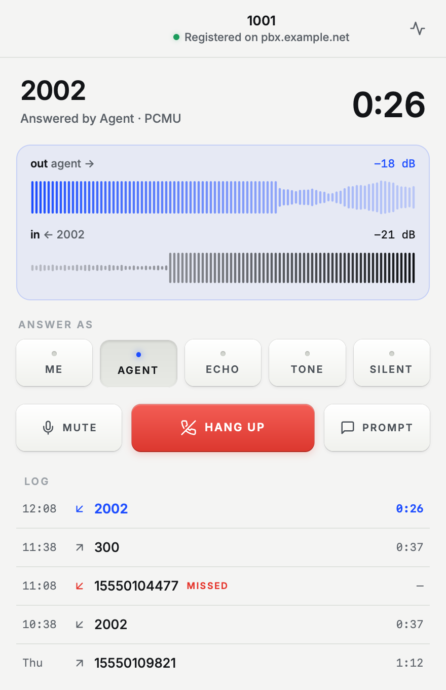
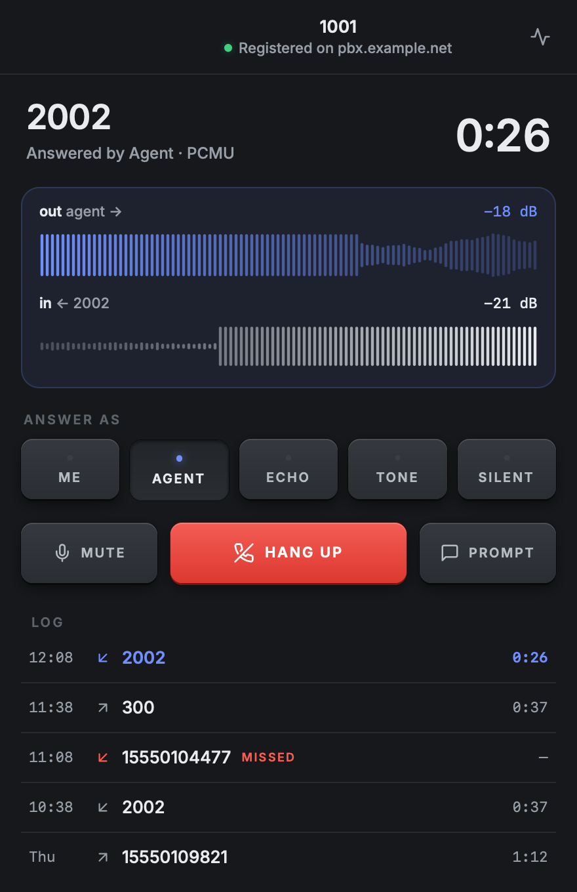
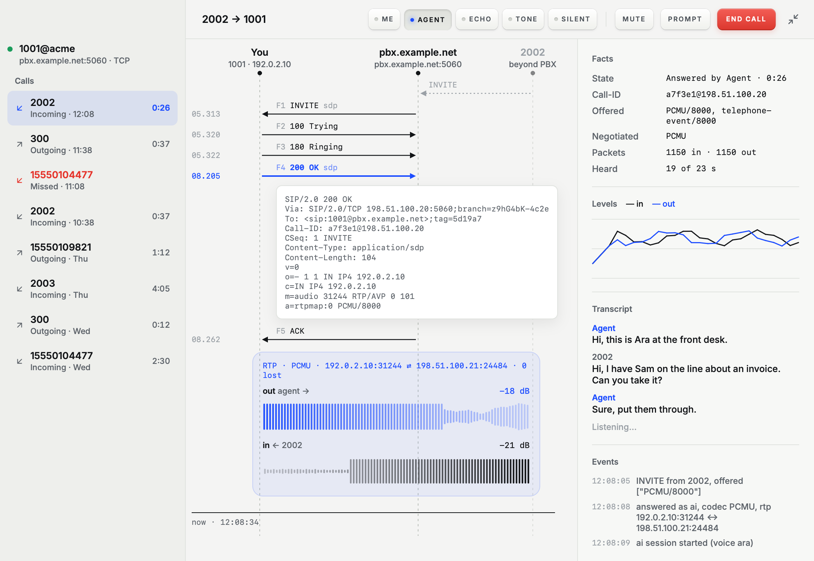

# softphone-use

A SIP softphone that coding agents can drive. It registers on your PBX like a desk phone, then
places and answers real calls through an HTTP API or an MCP server. A native window shows you
what is going on: is audio flowing both ways, who is talking, and every SIP message.

Each call can be answered by:

- **Me**: you, on your computer's microphone and speaker
- **Agent**: an AI voice agent (xAI realtime)
- **Echo**: sends back what it hears
- **Tone**: a steady 440 Hz tone
- **Silent**: sends silence

Every call is saved with its SIP trace, per-second audio levels, both sides as WAV and a
`call.json` summary. Use it to test IVRs, voice agents, call routing and audio paths end to
end, from a script or by asking your coding agent.

<p>
  
  
</p>

Press <kbd>⌘D</kbd> (<kbd>Ctrl</kbd>+<kbd>D</kbd> on Windows and Linux) for the debug view: the
call as a SIP ladder, raw messages, the negotiated media and the transcript.



## Install

```sh
npm install -g softphone-use
```

Or run it without installing: `npx softphone-use`. Prebuilt binaries cover macOS (Apple
silicon and Intel), Linux with glibc (x64 and arm64) and Windows (x64).

## Configure

softphone-use reads its settings from the environment, and from `.env.local` and then `.env` in
the directory you run it from. Variables already set in your shell win. Copy
[`.env.example`](.env.example) to start:

```sh
SOFTPHONE_SIP_USER=1001
SOFTPHONE_SIP_PASSWORD=secret
SOFTPHONE_SIP_DOMAIN=pbx.example.com
# Optional: where to send SIP, when it is not the domain.
SOFTPHONE_SIP_PROXY=sbc.example.com:5060
```

| Variable | Default | |
| --- | --- | --- |
| `SOFTPHONE_SIP_USER`, `SOFTPHONE_SIP_PASSWORD`, `SOFTPHONE_SIP_DOMAIN` | | The device to register as. Required. |
| `SOFTPHONE_SIP_PROXY` | the domain | Registrar or SBC, as `host:port`. |
| `SOFTPHONE_SIP_TRANSPORT` | `tcp` | `tcp` or `udp`. |
| `XAI_API_KEY` (or `SOFTPHONE_XAI_API_KEY`) | | Needed for Agent mode. |
| `SOFTPHONE_XAI_MODEL`, `SOFTPHONE_XAI_VOICE` | `grok-voice-think-fast-2.0`, `ara` | The agent's model and voice. |
| `SOFTPHONE_AUTO_ANSWER` | `manual` | Answer incoming calls by themselves: `human`, `ai`, `echo`, `tone` or `silent`. |
| `SOFTPHONE_AUTO_ANSWER_AFTER` | `2s` | How long to ring first. |
| `SOFTPHONE_RING_TIMEOUT` | `60s` | Give up on an outgoing call that is not answered. |
| `SOFTPHONE_HTTP_ADDR` | `127.0.0.1:7071` | The control API. |
| `SOFTPHONE_DATA_DIR` | `recordings` | Where calls are saved. |

The SIP password is never logged.

## Run

```sh
softphone-use            # register, serve the API and open the window
softphone-use daemon     # the same without a window, for CI and servers
softphone-use mcp        # MCP over stdio, talking to a running softphone-use
```

### With a coding agent (MCP)

Start `softphone-use` (or `softphone-use daemon`), then add the MCP server to your agent. For
Claude Code:

```sh
claude mcp add softphone -- npx -y softphone-use mcp
```

Any MCP client works the same way: the command is `npx -y softphone-use mcp`. The tools are
`status`, `dial`, `wait_for_call`, `answer`, `hangup`, `list_calls`, `get_call`, `get_levels`,
`get_sip` and `recent_sip`. A typical test: dial a number as Agent with a prompt, wait, then
read the call's transcript, levels and SIP to check what happened.

### HTTP API

Everything the window and MCP do goes through this API on `127.0.0.1:7071`.

| Method and path | |
| --- | --- |
| `GET /api/status` | Registration and active calls. |
| `POST /api/dial` | `{"to": "1002", "mode": "ai", "instructions": "...", "voice": "ara"}` |
| `POST /api/wait?timeout=60` | Waits for the next incoming call. |
| `POST /api/calls/{id}/answer` | `{"mode": "echo"}`. On an answered call, switches what talks. |
| `POST /api/calls/{id}/hangup` | Rejects or hangs up. |
| `GET /api/calls`, `GET /api/calls/{id}` | Calls with state, codecs, RTP addresses, events and an audio summary. |
| `GET /api/calls/{id}/levels` | Per-second levels in dBFS, in and out. |
| `GET /api/calls/{id}/sip` | Every SIP message of the call, with SDP. |
| `GET /api/calls/{id}/recording/in`, `.../out` | The call's audio as WAV. |
| `GET /api/sip` | Recent SIP messages across calls. |

```sh
curl -s localhost:7071/api/dial -d '{"to":"1002","mode":"echo"}'
```

## What a call records

Each call is saved in `recordings/<call-id>/`:

- `call.json`: who, when, codecs, RTP addresses, events, the agent transcript, per-second
  levels, every SIP message and an audio summary (seconds with sound, digital silence, packets
  in and out).
- `in.wav` and `out.wav`: 8 kHz audio, each direction.

Saved calls load again when softphone-use starts.

Agent calls are transcribed: what the agent said and what it heard. Other modes are not.

## Platform notes

- **macOS**: the first call as Me asks for microphone access for your terminal.
- **Linux**: needs ALSA (`libasound2`) and, for the window, Wayland or X11 with
  `libxkbcommon`. `softphone-use daemon` needs no display.
- **Windows**: the window uses Direct3D 12 and falls back to software rendering.

## Build from source

You need Rust (the version in `rust-toolchain.toml` installs itself through rustup). On Linux,
install `pkg-config libasound2-dev libwayland-dev libxkbcommon-dev libudev-dev libfontconfig1-dev`.

```sh
cargo run -- serve
cargo test
```

The window is built with [Rune](https://github.com/anomalyco/rune). In a debug build,
`cargo run -- --snap ui.png --scene in-call --theme dark` renders a demo state headlessly.
Scenes: `idle`, `dialing`, `ringing`, `in-call`, `agent`, `offline`, `debug`, `debug-ringing`
and `debug-ended`.

## Releasing

1. `pnpm release:version 0.2.0` sets the version in `Cargo.toml`, `Cargo.lock` and the npm
   package. Commit it and merge.
2. Tag the merge commit and push the tag: `git tag v0.2.0 && git push origin v0.2.0`.

The release workflow builds all platforms, creates a GitHub release with the binaries and
publishes `softphone-use` and its five platform packages to npm (`softphone-use-<platform>`,
and `softphone-use-windows-x64` for Windows). A version
with a suffix, such as `0.2.0-beta.1`, publishes under the `next` tag. Versions already on npm
are skipped, so re-running a release is safe.

npm authenticates the workflow with [trusted publishing](https://docs.npmjs.com/trusted-publishers):
on npmjs.com, add a trusted publisher to each of the six packages (GitHub Actions, repository
`voxtellai/softphone-use`, workflow `release.yml`). An `NPM_TOKEN` secret works as well. Packages
get provenance once the repository is public.

To publish a release by hand, download the run's `npm-packages` artifact and run
`node scripts/npm.mjs publish <dir>`.

## License

[Apache 2.0](LICENSE)
